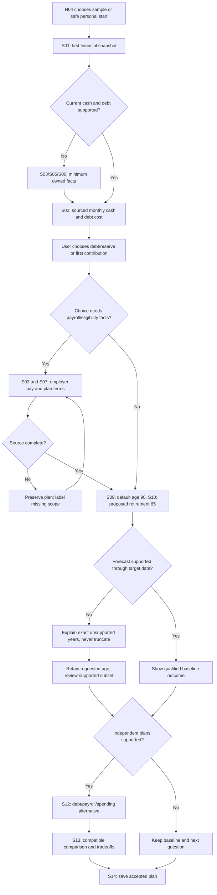
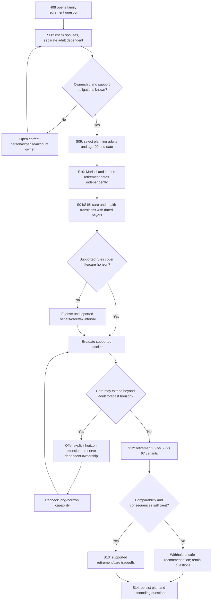
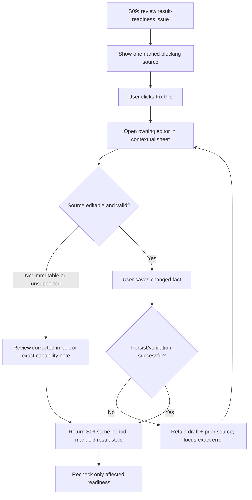
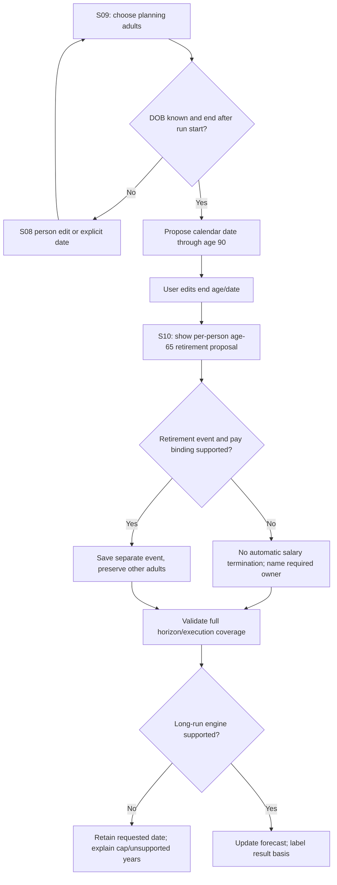
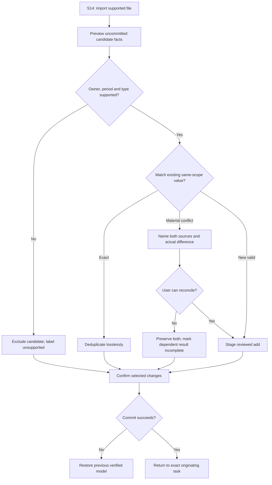
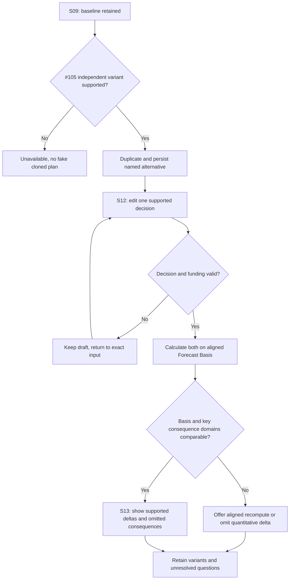

# Level 3 interaction traces — H04/H08 pilot plus all 33 use cases

**Status:** proposed interaction design, not implemented. Read with [evidence and navigation/screen contracts](level3-visual-baseline-navigation.md), [existing Level 2 audit](user-journey-level3.md) and PFA-UX-015–023. The explicit "S" surface IDs are defined in the navigation contract; they are conceptual screens mapped to current navigation, not new frontend routes or a request to create 17 distinct pages. No interface screenshot or executable fixture proving these end states currently exists. Pilot: **H04 Barlow primary**, **H08 Ortega complexity**.

## Interaction trace format and shared mechanics

Each numbered line states **user choice/action → system action and visible response → screen transition**. Each **exception** names the failure, what remains unmodified and the next user path. The system must retain `originTask`, `originSurface`, `model/person/account`, `period`, `plan identity`, `dirtyDraft`, and `result identity/freshness` through contextual repairs. These are behavioral invariants, not an implementation data-model mandate. "Save" means only the supported explicit persistence operation; the current app stores edits in memory until manual save, so don't claim auto-save.

### Reusable interaction primitives (one behavior, many entry points)

**I1 Task launch and return:** user selects a financial question from S01 or a contextual action → open the owning route with named person, period and task context, show a short human-readable heading and one priority action → complete, Cancel or Back returns to that original question retaining filters and scroll/focus. Page reload should restore only what persistence actually supports, never fictional in-memory state.

**I2 Same-authority review/edit:** user selects a named metric, object or warning → show current source, effective period, why it matters and one Review/Edit action → load the **existing single authoritative owner** (S03–S15) inside a sheet where feasible; common fields first, optional advanced fields collapsed. Save validates and marks affected result stale; Cancel leaves the original authoritative fact untouched; if immutable show corrected-source import, never a fake second editor.

**I3 Candidate ingest and conflict:** user authorizes a supported source in S14 → parse/type candidate facts without applying → preview owner, dates and matched existing facts, separate adds/updates/duplicates/conflicts → confirm individually or in a bounded reviewed group; exact same-scope duplicates merge losslessly, different-year/employer facts coexist, actual contradictions remain suspended with named repair. Failure retains previous verified model and source file/provenance only as authorized.

**I4 Contextual missing fact:** user hits a specific blocker → display one concise cause, supported incomplete consequence and Open source control → same-owner field focused; on Save return to interrupted plan/contribution flow and rerun readiness; on Cancel retain blocker and valid previous data. Technical IDs are never the default label.

**I5 Forecast request lifecycle:** user applies accepted plan setup → validate declared horizon, owner, person and binding, then issue a versioned request → visibly distinguish ready, running, stale, supported complete, partial, unsupported, failed and cancelled; a late response for an older request must never replace a newer result. Show last good dated outcome with a stale banner while running; never fabricate an unavailable period.

**I6 Independent plan evaluation:** user elects to explore an alternative → create named independent saved plan only when #105 available → edit dated decisions without modifying observed facts → require comparable Forecast Basis and show supported deltas, limitations and provenance. If copy, eval or basis alignment fails, preserve baseline and last verified variants.

**I7 Leave/save/return:** user navigates away from dirty editor, switches household, deletes or leaves → expose exact scope of unsaved work and available Save/Discard/Continue paths. The normal navigation can change with stable draft only when product persistence semantics explicitly support it; destructive actions require confirmation. Save errors retain local state; local-only/plaintext export restrictions remain visible.

**I8 Supported/default planning input:** when new plan requires an age/date or numerical planning assumption, resolve confirmed prior choice → if absent propose age 90 horizon, age 65 retirement for eligible working person or other approved numeric suggestions, clearly labeled *proposal* → user may accept/change/remove before plan apply. Never prefill real income, account values, eligibility, beneficiary, tax or benefit facts with generic numbers.

## S1 Explore and enter — cases E1–E5

### E1 Select synthetic demonstration (S00 → S01)
1. User chooses "Explore example", examines named example options and selects H04 or H08; system explicitly labels sample data as fictional, describes the financial question and whether each model capability is available.
2. User chooses "Open example"; system verifies fixture identity/source and creates isolated demo session, then routes to S01 with current snapshot visible and prominent "Explore this question".
3. User chooses another example; system checks any dirty draft and confirms destructive replacement when necessary.
**Exception:** no 8-persona fixture implemented (#108), fixture corrupt, or run unsupported → show an honest capability state and offer currently supported synthetic example; do not counterfeit a persona or import real data. **Proof:** source household label persists on all screens; no personal model overwritten.

### E2 Start my finances (S00 → S14/S08/S03 → S01)
1. User chooses "My finances"; system shows local data/save/privacy boundary and available supported import/manual paths without presenting connection as available until adapter exists.
2. User chooses manual → request minimal household identity, no fake recorded-dollar defaults; choose import → S14 preview uncommitted candidates.
3. After explicit Save/Finish with valid subset, S01 shows supported current metrics and the first recommended question; the rest remains optional and task-scoped.
**Exception:** declined permission or failed parser → no authoritative mutation, return to input-method chooser; absent DOB does not block present-day cash overview. **Proof:** can start with no investments, 1 account or no asset balance, with honest coverage.

### E3 Resume saved work (S00 → S01 or recover in S14)
1. User selects "Resume", chooses available stored model and sees last persisted date, model identity and privacy mode.
2. System validates format/version and preserves source provenance/plans; shows current data-as-of separately from last computed result.
3. On success navigate S01 and offer Return to last question; stale forecast is not silently labeled current.
**Exception:** incompatible, migration-needed or corrupted model → no overwrite; show supported migrate/backup/import actions at S14 and safe return to S00. **Proof:** same saved facts after reload; no silent recreation.

### E4 Switch/reset/discard (any screen → S00/S01)
1. User chooses "Switch example", "New model", or "Reset"; system checks active model class and dirty model, editor or pending forecast.
2. If destructive, show exact target and old model identity, Confirm/Cancel; Cancel restores identical source screen and focus.
3. On confirm, separate demos/personal identities and clear only explicitly selected session state.
**Exception:** failure during reset/replacement → retain previous verified model, announce no completed reset. **Proof:** cannot overwrite personal data through demo change.

### E5 Understand limits before commitment (S00/S01 → relevant S15/S09)
1. User opens "What can I learn?" for selected household; system lists 2–3 supportable questions, model coverage and material unsupported domains, plain-language.
2. User picks question; navigate directly to current fact/forecast or exact scope gap rather than an unfocused wizard.
3. If a requested domain (special-needs trust/estate tax/RSU/NYC split residency) is unsupported, show what can still be answered and a safe alternative.
**Exception:** no safe conclusion → show requirements for a bounded fact-based starting observation, not a universal risk score. **Proof:** no claim an unavailable feature works.

## S2 Understand current finances — cases P1–P5

### P1 Decide who is included (S01 ↔ S08; H08 owner/dependent)
1. User chooses household/person summary and "Who is included?" → open S08 with individual owners, shared/linked relationships and scoped totals.
2. User chooses view "Both planning adults" or an individual; system recomputes read-only sums for only authorized economic owners, displaying assets, liabilities and separately supported dependent-care obligations.
3. User inspects a questionable ownership label → I2 same-person or account owner edit; return S01 with unchanged unrelated balances.
**Exception:** an adult dependent or independently owned account lacks financial-control evidence → mark excluded/unassigned, never pool automatically; named source review offered. **Proof:** H08 Avery's separately owned assets never become parents' assets without explicit permitted source.

### P2 Inspect income vs spending (S01 → S02 → S03/S04/S05)
1. User opens "Money left each month", selects period and family scope; S02 lists source-qualified gross pay, actually posted take-home where available, essential/discretionary spending, mortgage payment, transfer and contribution separately.
2. User chooses a category or named income → open S03 or S04 via I2 and focused field; bank destination goes to S05; after Save the same month remains selected and results refresh or show stale.
3. User asks "What can I change?" → show actionable expense or debt component, do not claim payroll withholding or contribution funds are cash available to spend unless reconciled.
**Exception:** tax withholding, account or transaction period absent → show gross/estimated rather than precise net, label missing scope and direct S03/S05 repair; avoid double-counting payments/transfers. **Proof:** H04 cash surplus arithmetic traceable.

### P3 Understand assets, liquidity and debt (S01 → Net Worth Overview/S05/S06/S07)
1. User picks "What I own vs owe"; show liquid cash, investments, property and outstanding debt at supported valuation dates; group by owner.
2. User selects mortgage → S06 contract, current principal, bank funding and interest; selects investing → S07 account summary, not every holding expanded.
3. User selects a surprising total → source/date with repair via I2.
**Exception:** stale asset quote, mortgage origination principal confused with current balance or duplicated account → qualify only affected subtotal and expose source/date correction; don't invent equity or current cash. **Proof:** H08 inaccessible retirement accounts aren't counted as immediately spendable bank cash.

### P4 Find one priority insight (S01 ↔ S02/S06/S07)
1. User selects "What needs attention?"; system finds *supported* comparisons of income vs recurring obligations, debt cost, reserves and portfolio concentration, with caveats/period.
2. Offer no more than a short ordered list and a clear first task with "why" in context; user chooses one.
3. Route directly to S02, S06 or S07 relevant object with a return link to S01.
**Exception:** incomplete income/tax/care data or no investments → do not label absence as error or guess a score; show one factual insight and most useful specific missing fact. **Proof:** H04 sees debt/reserves without an invented portfolio.

### P5 Trace questionable number (S01/S02/S06/S07 → S16)
1. User selects any displayed metric's "How calculated?" → show owner, date, formula inputs only when supported, source and assumption/known status.
2. User requests correction → I2 opens same authoritative S03/S04/S05/S06/S07/S08 owner in-context; show one Save/Cancel.
3. Save causes only affected derived results to refresh/stale; return to original metric; no competing writer created.
**Exception:** immutable import source → offer corrected import/reconciliation instead of editable fake mirror; unsupported formula → show unavailable rule, not an input-error prompt. **Proof:** one owner action from both main view and mirror.

## S3 Build trusted inputs — cases R1–R6

### R1 Choose source and authorize (S01 → S14 → S01/S09)
1. User decides "Add accurate data" and chooses supported import or manual method; system explains origin permissions and whether bytes leave the browser.
2. If import, preview candidate counts separated current balances, historical transactions, economic facts and future assumptions; user reviews owner, date, provenance and rejected rows.
3. Only user-approved valid candidate scope becomes authoritative; return to initiating question or S09 readiness check.
**Exception:** unsupported CSV/layout/provider, permission denial, mismatched identity, parser error → no partial overwrite; retain old model and precise reason, manual alternative. **Proof:** unapproved extract is never an annual tax fact.

### R2 Reuse unchanged known values (S09/S03/S08)
1. User opens a task that needs date of birth, salary, bank or retirement account; resolver checks exact person/sponsor/plan/tax-year/period/provenance.
2. For valid existing same-scope fact, show read-only sourced value and direct edit; never ask again merely because screen or year changed.
3. For missing/out-of-scope fact, highlight only one required owner and why it affects result; use I4 focus and return.
**Exception:** earlier-year filing/eligibility, new employer or changed coverage → no evergreen carry-forward; retain historical source and request dated current authority. **Proof:** H08 two distinct employer retirement plans are never conflated.

### R3 Review approved defaults (S09/S10/S11)
1. User views "Planning starting points": timeline through age 90 of selected planning adult(s), individual proposed retirement age 65 for eligible workers, and suggested general inflation/pay/return/reserve values where appropriate.
2. System labels each as "Suggested planning assumption", shows units, owner/scope and what it affects; source-specific employment/loan/plan contract values supersede suggestions.
3. User accepts, changes, removes or leaves undecided; only accepted configuration persists when applying the plan.
**Exception:** DOB unknown, current age >65/90, no income growth source, unsuitable portfolio return, existing explicit plan → preserve existing choice or ask, no retroactive retirement and no implied death. **Proof:** H04 age 90 ~45-year horizon; no hidden 40-year cap.

### R4 Resolve candidate conflict (S14/S16 → owner → origin)
1. Review named candidate and existing source with date, employer/account/person, period and consequence; distinguish genuine conflict from legal distinct scopes.
2. User selects "Use existing", "Use reviewed correction" or "Keep unresolved"; no automatic newest-wins, and the originals retain provenance.
3. On resolution, validate once and recalculate dependency status; return to origin on Save, unchanged on Cancel.
**Exception:** cannot adjudicate → preserve sources, block only affected result, permit other current information to display. **Proof:** repeated import does not duplicate cash or contribution history.

### R5 Specific result readiness (S09 → S16 or run)
1. User asks for an age-90 forecast; system checks factual coverage, plan horizon, linked payroll/retirement events, funding, law and actual engine support **for this result**.
2. Show grouped "Ready", "Needs one fact", "Partially modeled", "Unsupported" with one prioritized direct owner action; do not render a wall of raw diagnostic buttons over unrelated screen.
3. User fixes named cause using I4; on return readiness refreshes; if complete, primary "Update forecast" available.
**Exception:** unsupported future-law/tax/benefit period or 40-year capacity → exact unsupported interval/capability, preserve requested end age/date and old good result; do not relabel as user typo. **Proof:** H08 dependent lifetime-care completeness explicitly scoped.

### R6 Save, reload and recover (S14 → S00/S01)
1. User presses "Save model" in trusted-origin mode and receives last-saved identity/time only when storage succeeds; export explains plaintext sensitive content.
2. Reload/resume uses actual persisted records and separate result freshness; returning user may inspect past plan before rerunning.
3. If saving while edit dirty, explain choice to finish edit/cancel before persisting, without fake atomicity.
**Exception:** public/demo origin disables durable browser persistence, disk/storage failure, wrong identity, interrupted migration → no success toast, preserve in-memory state while available, retain previous verified save and offer supported backup path. **Proof:** failed Save never claims durability.

## S4 Understand the baseline — cases F1–F5

### F1 Choose plan horizon and each retirement event (S09 ↔ S08/S10/S11; H04/H08)
1. User selects "See my future"; S09 names current plan, planning adults, as-of, forecast end age/date, forecast coverage and future known obligations. Initial end age 90 uses selected adult birth date; for two selected spouses use the later 90th birthday.
2. User taps "Change end age" or date; system updates the linked display deterministically, validates future/inclusive range and preserves separately chosen simulation run window. New plan's age 90 never means an assumed death.
3. User taps retirement suggestion for a named working adult; S10 shows editable proposed age 65 and date, source event and salary-termination binding status. Editing H08 Marisol's retirement does not change James's. S09 receives status on Save.
**Exception:** unknown DOB, already past age 65/90, nonselected dependent, event after forecast end, invalid payroll termination binding or >40-year engine cap → prompt exact source or explicitly supported date; preserve desired plan age when execution unavailable. **Proof:** H08 dependent-care tail prompts extension without adding dependent as accidental horizon anchor.

### F2 Start/version/cancel forecast (S09 → result on S09/S01)
1. User presses "Update forecast" after material readiness disclosures; system freezes requested plan/horizon/source snapshot/basis and issues one identifiable run, with a visible progress/cancel affordance when supported.
2. UI shows status without obscuring existing current-state metrics; if a last good forecast exists it remains accessible *marked stale*.
3. On completed current request show supported result and coverage; request IDs/order prevent a late older response replacing newer result.
**Exception:** validation fails, run cancels/errors/times out or engine refuses extension → preserve old result + source, show scoped reason and safe retry after correction; no fake completion or truncated horizon. **Proof:** changing age twice quickly cannot surface prior older age as current.

### F3 Interpret a result (S09/S01 → metric drill-down → owner)
1. User sees age timeline, future liquidity, assets, debt, retirement spending and material points of strain; each chart names period, dollar basis, plan and result status.
2. User selects a surprising future year/negative cash region → see plain-language drivers, assumptions, source owners and exact scope; choose a linked owner correction or alternative plan exploration.
3. Return to S09/S01 with time point selected and properly refreshed or stale result.
**Exception:** taxes/benefits incomplete or outcome not computed → withhold the affected after-tax or affordability claim, not a neutral zero; never translate deterministic cash path into a probability. **Proof:** H04 cannot be promised safe retirement based on incomplete long-run tax.

### F4 Inspect coverage and limitations (S09 → details/S08/S11)
1. User chooses "What is included?" beside a forecast; show included persons, dates, source basis and modeled domains versus explicitly unmodeled consequences, grouped by relevance.
2. User selects specific missing condition, e.g. H08 special-needs benefits, extended care or post-forecast survival → show why it may change conclusion and whether there is an available source input or unavailable engine feature.
3. If fixable route to same owner; if unsupported return to qualified result with clearly constrained interpretation.
**Exception:** incomplete projected tax law/unsupported medical rules → do not ask user to invent tax rules or class benefits as zero. **Proof:** survivor-dependent-care affordability never labeled complete when necessary support missing.

### F5 Revise future assumption or revert (S09 ↔ S10/S11/S08)
1. User edits approved plan assumption, horizon, income-bound retirement event or named future care expense; editor shows current plan identity and what changes are proposed.
2. User reviews Save/Cancel plus calculated affected period. Save persists only authorized scope and invalidates relevant results; Cancel leaves original plan/forecast unchanged.
3. Returning to S09, the single Update forecast action indicates fresh recomputation needed, and last old forecast remains labeled stale until replaced.
**Exception:** dated event beyond horizon, invalid funding, unsupported contribution rule, concurrent edit, partial projection → inline named validation or exact capability boundary; retain previous result and editable draft. **Proof:** H08 age 62 vs 67 belongs to alternatives not silent baseline overwrite.

## S5 Compare decisions — cases C1–C6

### C1 Create independent plan (S09 → S12)
1. User chooses "Compare another option"; system explains original is unchanged and, only if #105 supported, offers Duplicate + name.
2. User confirms variant; system creates independently persisted identity and copies allowed plan decisions with the same source snapshot.
3. Route to S12 focused on one choice; show baseline and alternative labels on every subsequent page.
**Exception:** #105 not available, duplicate/save fails or conflict arises → do not show an unsaved simulation as independently stored; remain S09 with baseline safe.

### C2 Change choice in alternative (S12 → S10/S06/S04/S07 → S12)
1. User picks choice type (retire earlier; spend less; pay debt faster; support adult dependent); selects named person, account, amount, effective date and source funds where needed.
2. System reveals only relevant parameters and same-authority linked owner, records *future decision overlay* rather than changing observed starting balances/wages.
3. User confirms change; S12 summarizes what changed and what stays shared, then offers evaluate.
**Exception:** not modeled or economic constraints violated → show affected missing rule, save as draft only if supported and clearly incomplete; no external financial action executed. **Proof:** H04 payroll contributions never funded from a bank by accident.

### C3 Establish comparability (S12/S13)
1. User selects baseline and named alternative; system checks same starting source facts, people, dates, horizon, law/calibration version and evaluation fidelity (Forecast Basis).
2. If compatible, calculate both; if not, show exact differing basis and "Recompute using same basis" only when supported and agreed.
3. After successful aligned results navigate S13 side-by-side with visible basis and coverage.
**Exception:** unavailable law/run/horizon or mismatch cannot be aligned → no raw numeric delta; allow separate labeled plans and return to edit. **Proof:** a 90-year baseline cannot be deceptively compared to a 40-year variant.

### C4 Explore tradeoffs (S13 → S09 or result detail)
1. User reviews only meaningful changed decisions and supported differences in cash/liquidity, future spending, debt service and retirement affordability; risk metrics only once their evaluation semantics exist.
2. User selects a difference → inspect common source, assumptions and sensitivity/caveat; can return to either named plan with intact state.
3. Show plural tradeoffs rather than a hidden absolute winner.
**Exception:** H08 care/public benefit, H02 rental tax or H03 RSU omissions materially affect ranking → withhold dependent decision claim, label unavailable consequence. **Proof:** no "optimal" label without applicable authority.

### C5 Save, switch, reset a variant (S13 ↔ S12/S09/S14)
1. User chooses alternative A/B or baseline; system changes active plan identity without editing others and shows variant-specific run freshness.
2. User chooses Save, Discard pending edit, Delete variant or Return to original; destructive paths confirm affected plan only.
3. Return S13 with prior pair selection unless one was deleted, then request a new pair.
**Exception:** save/reload version race, failed duplicate, stale result → retain last verified definitions and refuse misleading current-delta display. **Proof:** original household and baseline never mutated by comparison.

### C6 Decide with uncertainty (S13 → S06/S07/S15 or S6)
1. User chooses a provisional path, follow-up question or "Not enough information"; system summarizes changed assumptions, supported benefits, tradeoffs and missing evidence.
2. User can keep multiple options; if no clear favorite, user records what must be learned next.
3. Route to S6 review/goals; an in-app preference does not make a bank transfer, portfolio trade or retirement election.
**Exception:** outcome incomplete → no universal best plan or confident recommendation; prompt a supported next question.

## S6 Decide and revisit — cases A1–A6

### A1 Choose a feasible next step (S01/S13 → S6 task context)
1. User reviews a short summary ("Based on supported model inputs") identifying next supported financial question/action; distinguish a modeled decision from something requiring external execution.
2. User selects "Review debt", "Check employer match" or "Revisit retirement ages"; route with named object/period, not generic settings.
3. User marks a question as reviewed or holds off; preserve plan's meaning and its limitations.
**Exception:** insufficient net-pay or contribution eligibility → not "invest X dollars"; ask to review exact missing source.

### A2 Persist and exit (any → S14/S00)
1. User presses Save model/plan; system checks dirty editors, manual browser persistence mode, current model identity and result coverage.
2. On success show confirmation with durable save time and whether result is a retained snapshot; recommend separate secure backup where appropriate.
3. User exits or switches; saved vs unsaved is explicit.
**Exception:** failed/local-disabled save → keep draft in memory during current session only, show plaintext export risks, never promise recovery after closing.

### A3 Return without restart (S00 → S01/S09)
1. User resumes matching saved model and named plan; system loads only committed data and shows as-of plus last forecast identity.
2. Re-resolve same-scope values for this date, showing changed/out-of-date evidence as specific attention items.
3. User chooses resume question or Update forecast; do not rerun a full wizard or retype DOB/accounts.
**Exception:** migration, missing origin permission or expired source → exact recovery S14 or owner, preserve prior saved bytes. **Proof:** H08 care support and independent spouse retirement decisions persist separately.

### A4 Record life change (S01/S09 → S03/S04/S08/S10)
1. User chooses "Something changed" and a recognizable category: job/pay, family/member, new home/debt, account, care costs, coverage or retirement.
2. System routes to single owner with **effective date**, shows existing scope and asks only newly changed facts.
3. On Save, old dated facts remain historical evidence and only affected dependent plans/results become stale; user returns to S01/S09.
**Exception:** new employer plan conflicts with old sponsor, coverage lapses or imported income differs → reconcile named sources or preserve incomplete domain; no blind future-year carryover.

### A5 Refresh changed conclusions (S09/S13)
1. User sees material changed input/basis marker and selects Update forecast or Recompute comparison.
2. System identifies affected plan/result, validates relevant inputs, runs supported updated outcome while retaining previously valid snapshot.
3. On completion update freshness and visible what changed; leave untouched plans/results unchanged where dependencies truly invariant.
**Exception:** long horizon unsupported or compute fail → keep old snapshot stale with source date and named action, never relabel as current.

### A6 Leave, change identity or delete safely (any → S00)
1. User requests navigate away from dirty state, delete model, switch persona or export; system names consequences and offers Keep editing, Save if supported, Discard only named draft, Cancel.
2. Confirmed destructive action checks target identity and preserves unrelated saved households/immutable provenance as governed by retention policy.
3. Return to S00 or selected destination with clear confirmation only when action actually succeeded.
**Exception:** persistence fails, user cancels, model is open in another tab or cannot be recovered → do not destroy last verified data or falsely claim completion.

## Two end-to-end pilot activity diagrams

### H04 Barlow: first useful insight to first retirement decision

### H08 Ortega: multi-adult retirement and lifelong dependent care

## Four task-level decision and recovery diagrams

### Contextual repair from a forecast limitation

### Forecast horizon and retirement ownership

### Source ingest and material conflict

### Independent alternatives and fair comparison

## Required independent proof matrix

**Level 3 contract completeness** is determined by whether a test author/designer can unambiguously identify the starting state, choice, destination, authority, outcome, error and return. It is **not** demonstrated by GitHub spec-check green status alone.

| Evidence | H04 primary | H08 complexity | Method / owner |
| --- | --- | --- | --- |
| S00 first start, reset and persistence | Missing investments does not force failure, source separation | No accidental demo/personal switch | Browser checks + PM goal-based UAT |
| S01/S02/P1–P5 current state | Cash, debt, spend clear; no fake investing account | Separate spouse/child ownership; funded care cost | Synthetic financial fixture comparison + UAT |
| S03–S08/R1–R6 entry/reuse/conflict | One salary/bank source, effective period, no repeated DOB | Two employers/plans, person and coverage dates | Unit/integration + browser contextual repair |
| S09/S10/S11/F1–F5 defaults | Age 45→90 >40 year horizon, age-65 editable salary binding | Two retirement ages; later spouse's age-90 date; dependent-care tail | Long-run engine performance/incomplete-law, browser and owner UAT |
| S12/S13/C1–C6 alternatives | Spending vs debt vs payroll source tradeoff | Retire 62/65/67 and care scenario limitations | P1/#105 implementation + independent plan comparison audit |
| S14/A1–A6 save/revisit | Reload and targeted correction without whole wizard | Separate spouse status/last good result and care updates | Persistence integration, browser and PM UAT |
| 1440px and 390px first screenful | One named action and compact status | Owner/date & retirement alternatives accessible | Manual UX evidence + accessibility review |

**Stop conditions:** no visual sign-off without actual current-target screenshot baseline for S00/S01/S02/S06/S07/S09/S10/S13, and do not mark #120 design-ready for Codex on an unapproved mock. No user-facing long-horizon result may be presented complete before exact engine law/capability coverage is demonstrated. No task's failure branch may corrupt or silently overwrite a baseline source fact or independently saved plan.
